# png2svg

`png2svg` converts a PNG image to a compact SVG image. It is useful for logos,
icons, text and diagrams that need clear edges at different sizes. Transparent
areas stay transparent. You choose how much detail to keep with one number
from 1 to 100.

The goal is the smallest SVG file that keeps the details of the source image.
Photographs and smooth gradients are less suitable and can produce larger files.
This is a command line program. You use it in a terminal, not in a graphical
window.

* [About](#1-about)
* [User guide](#2-user-guide)
* [Architecture and algorithms](#3-architecture-and-algorithms)
* [Developer guide](#4-developer-guide)
* [License and attribution](#license)

## 1. About

For example, a 512 x 512 PNG logo with soft edges and a transparent background
is 10 619 bytes. The converted SVG is **2 481 bytes** and looks almost the same.

What you get:

* SVG shapes with smooth curves and lines instead of a fixed grid of pixels.
* Transparent areas and partly transparent shadows.
* A choice between more detail and a smaller file.
* The same result bytes for the same input and options on every supported system.

Binary releases are available for macOS Apple Silicon (M1, M2, M3, M4 and
later), Linux x86_64, and Windows x64. Windows users can also use the Linux
x86_64 binary through WSL2. Intel macOS and Linux ARM64 releases are paused.
You do not need Rust or programming tools to use a release binary.

## 2. User guide

### Install

#### macOS, Linux and WSL2: shell installer

Open Terminal on macOS or a terminal on Linux. If you prefer WSL2 on Windows,
follow [Windows with WSL2](#windows-with-wsl2) and use its Ubuntu terminal.
For a native Windows installation, use the PowerShell installer below.

Download the installer from the latest
[GitHub release](https://github.com/kiryl-vd/png2svg/releases):

```bash
curl --proto '=https' --tlsv1.2 -LsSf https://github.com/kiryl-vd/png2svg/releases/latest/download/png2svg-installer.sh -o png2svg-installer.sh
sh png2svg-installer.sh
```

The installer selects the binary for your system. It does not compile the
program. Follow its instructions for your terminal, or close and open the
terminal again. Check the installation:

```bash
png2svg --version
```

If the releases page is empty, a binary release is not available yet.

#### Windows x64: PowerShell installer

Open PowerShell and download the Windows installer:

```powershell
Invoke-WebRequest https://github.com/kiryl-vd/png2svg/releases/latest/download/png2svg-installer.ps1 -OutFile png2svg-installer.ps1
powershell -ExecutionPolicy Bypass -File .\png2svg-installer.ps1
```

The execution policy option applies only to this installer process. It does
not change the permanent PowerShell policy. Follow the installer instructions,
then close and open PowerShell again:

```powershell
png2svg --version
png2svg "$HOME\Downloads\logo.png"
```

This installs the native `png2svg.exe`. WSL2 is not required.

#### Alternative: download an archive

Download the archive for your system from
[GitHub Releases](https://github.com/kiryl-vd/png2svg/releases).

| System | Archive |
|---|---|
| macOS, Apple Silicon | `png2svg-aarch64-apple-darwin.tar.xz` |
| Linux or WSL2, x86_64 | `png2svg-x86_64-unknown-linux-gnu.tar.xz` |
| Windows, x64 | `png2svg-x86_64-pc-windows-msvc.zip` |

On macOS, **Apple menu > About This Mac** shows your Apple chip.
On Linux or WSL2, `uname -m` must show `x86_64` for the published Linux binary.
On Windows, **Settings > System > About > System type** shows whether your
processor is x64.

Each archive contains the program, this README and the MIT license. Extract it
with your archive application or with `tar -xf <archive-name>`. In a terminal,
use `cd` to enter the extracted directory. You can then run the program with
`./png2svg` instead of `png2svg`:

```bash
./png2svg --version
./png2svg "$HOME/Downloads/logo.png"
```

On Windows, extract the ZIP archive with **Extract All** in File Explorer.
Open PowerShell in the extracted directory and run:

```powershell
.\png2svg.exe --version
.\png2svg.exe "$HOME\Downloads\logo.png"
```

For use from any directory, use the installer for your system or copy the
program to a directory in your `PATH`, the list of directories your terminal
searches for commands. The release also contains SHA-256 files to check the
downloads. Linux binaries need glibc. They are not Alpine Linux (musl) builds.

### Convert your first image

Open a terminal and enter the path of your PNG image:

```bash
png2svg "$HOME/Downloads/logo.png"
```

This creates `logo.svg` in the same directory as the PNG. The source PNG is
not changed. The program prints the path of the SVG. Open that file in a
browser or an application that supports SVG.

Use quotes around paths that contain spaces:

```bash
png2svg "$HOME/Downloads/My logo.png"
```

If your terminal is already in the image directory, the command is shorter:

```bash
png2svg logo.png
```

To choose another result name:

```bash
png2svg logo.png result.svg
```

The result directory must already exist. If an SVG with that name exists,
the program uses the next free name, such as `logo-02.svg`. It does not
overwrite files unless you use `--force`.

### Choose the detail level

The default is `100`, which keeps the most detail. Lower values usually give
smaller files with fewer colors and simpler shapes:

```bash
png2svg --detail 50 logo.png
```

| Kind of image | Advice |
|---|---|
| Logo, flat icon, text, diagram | `100` by default. For a very small file, try `60` to `75`. |
| Icon with soft shadows | `100`, or `75` if the file must be small. |
| Pixel art | `100`. Pixel art keeps its exact pixel edges at every level. |
| Screenshot | `75` to `100`. |
| Photo | `25` to `50` for a simplified image with a small file. A high level can make a big file. |
| Smooth gradient | `50` to `75`. The gradient is drawn in steps. |

To remove a solid background that touches the image border:

```bash
png2svg --remove-background logo.png
```

This only removes the border color where it is connected to the border.
It does not remove an isolated area of the same color inside the image.

### Options and examples

```text
png2svg [OPTIONS] <INPUT> [OUTPUT]
```

| Option | Default | Meaning |
|---|---|---|
| `-d`, `--detail <1..100>` | `100` | Level of detail. 100 keeps the most detail. 1 uses the simplest settings. |
| `-f`, `--force` | off | Overwrite the result file if it exists. |
| `-o`, `--output <PATH>` | none | Another way to give the result path. Do not also give a positional result path. |
| `-v`, `--verbose` | off | Print size, colors, regions, paths, file size and time of every step. |
| `-q`, `--quiet` | off | Print nothing except errors. |
| `--colors <2..256>` | from detail | Largest number of colors. Overrides the color limit from `--detail`. |
| `--precision <0..3>` | from detail | Number of decimal places in the coordinates. |
| `--remove-background` | off | Make the image border color transparent where it connects to the border. |
| `-h`, `--help` | | Print the help. |
| `-V`, `--version` | | Print the version. |

```bash
png2svg logo.png                     # writes logo.svg, or the next free name
png2svg logo.png out/logo.svg        # the directory must exist
png2svg -d 40 photo.png              # less detail, usually a smaller file
png2svg --force logo.png logo.svg    # overwrite the existing SVG
png2svg -v -d 80 icon.PNG            # include conversion statistics
```

`--detail 50`, `--detail=50`, `-d 50` and `-d50` are equivalent.
Short flags can be grouped (`-fv`). Options and arguments can be in any order.
Use `--` before a file name that starts with `-`.

### Result file names and safety

* Without a result path, the last extension is replaced with `.svg`:
  `a.PNG` becomes `a.svg`, `my.logo.png` becomes `my.logo.svg`, and
  `image.dat` becomes `image.svg`. A name without an extension gets `.svg`.
  The result directory is the same as the source directory.
* If the result exists, the program adds `-02`, `-03`, and so on before the
  extension. It uses the first free name. If `a.svg` and `a-03.svg` exist,
  the result is `a-02.svg`. Numbers continue after `-99`, up to `-9999`.
* This rule also applies to an explicit result path. An existing suffix stays
  part of the name: `a-02.svg` becomes `a-02-02.svg`. A name without an
  extension gets the suffix at the end, such as `out-02`.
* `--force` uses exactly the result path you specify. If writing fails, an
  existing result stays unchanged.
* The result cannot be the source file or a directory. Missing result
  directories are not created.
* Paths with spaces, Unicode characters and WSL2 paths such as `/mnt/c/...`
  are supported.

### Windows with WSL2

WSL2 is optional. Use this method if you prefer the Linux version instead of
the native Windows program. These instructions are for x64 Windows.

1. In a Windows terminal, install WSL2 and Ubuntu:

   ```powershell
   wsl --install -d Ubuntu
   ```

2. Open the Ubuntu terminal and use the shell installer from the
   [Install](#install) section. You do not need to install Rust.
3. Windows files are available under `/mnt/c/...`. For example:

   ```bash
   png2svg "/mnt/c/Users/Me/Pictures/logo.png"
   ```

   The SVG is written to the same Windows directory. Open it in a browser
   on Windows.

Use the Linux path with forward slashes, or convert a Windows path:

```bash
png2svg "$(wslpath 'C:\Users\Me\Pictures\logo.png')"
```

Files in `/mnt/c/...` are slower than files in the Linux file system, but
reading one image is fast either way.

### Limits and common errors

* **Photos can give big files.** Use a lower detail level if the SVG is too big.
* **Gradients are drawn in steps.** This version does not write SVG gradients.
* **Very small images may not become smaller.** The test pixel art image is
  476 bytes as PNG and 1 058 bytes as SVG.
* **Soft shadows** use a limited number of opacity levels.
* **Thin light lines** can appear between touching shapes at some zoom levels,
  especially next to a transparent area.
* **Color profiles** are ignored. Colors are interpreted as sRGB.
* **Animated PNG:** only the first frame is converted.
* Only PNG input and SVG output are supported. There is no batch mode or
  graphical interface.

If the program reports that a file is missing, check its path and use quotes
if it contains spaces. If the result directory is missing, create it first.
A damaged PNG gives an error instead of an SVG. Use `png2svg --help` for the
full command syntax.

## 3. Architecture and algorithms

The program has **no runtime dependencies**. The PNG decoder, DEFLATE
decompressor, vectorization and SVG writer use only the Rust standard library.

### Conversion pipeline

```mermaid
flowchart LR
    A[PNG file] --> B[PNG decoder<br/>inflate, filters, Adam7]
    B --> C[RGBA 8 bit]
    C --> D[Remove blend pixels<br/>anti-aliasing]
    D --> E[Quantize colors<br/>Oklab, k-means++]
    E --> F[Regions<br/>4-connected, merge noise]
    F --> G[Trace boundaries<br/>shared arcs on pixel corners]
    G --> H[Smooth, find corners]
    H --> I[Fit cubic Bézier curves<br/>once per arc]
    I --> J[Layers, underlay]
    J --> K[Short SVG text]
```



1. **Decode** (`src/png`). All color types and bit depths, `tRNS`, Adam7, all
   filters, several `IDAT` chunks. The CRC of every chunk and the Adler-32 of
   the zlib stream are checked. Extra chunks, including APNG animation chunks,
   are ignored, so an APNG is read as its first frame.
2. **Remove blend pixels** (`unblend.rs`). A pixel on a soft edge is a mix of the
   two colors next to it. It would make a thin ring of extra regions around
   every shape. A pixel that lies on the line between the colors of two
   opposite neighbors is replaced with the nearer neighbor. The renderer makes
   the soft edge again from the smooth outline. Images with 24 colors or fewer
   are not changed.
3. **Quantize** (`quantize.rs`). Pixels with alpha below 8 are transparent. The
   other alpha values are rounded to a few levels. Colors are grouped with
   weighted k-means in the Oklab color space (k-means++ start, fixed seed).
   Colors that cannot be seen as different are joined. If the image has
   fewer colors than the limit, the colors stay exact.
4. **Regions** (`segment.rs`). 4-connected areas of one color. A region that is
   smaller than the minimum area is merged into the neighbor with the closest
   color.
5. **Trace** (`trace.rs`). The boundaries follow the pixel corners, not the
   pixel centers. A boundary between two regions is one *arc* that both regions
   share. This prevents geometry gaps from independent outline fitting.
6. **Smooth and corners** (`simplify.rs`). The staircase is smoothed with a short
   moving average. Sharp turns are corners and stay sharp (like `alphamax` in
   potrace). Small shapes use the exact corners of the pixel edge.
7. **Curves** (`bezier.rs`). Schneider's method fits cubic Bézier curves with
   the maximum distance of the tolerance. Nearly straight curves become lines.
   An arc is fitted once and used by both regions. Coordinates are rounded
   once per arc.
8. **Layers** (`vectorize.rs`). One path per color. The biggest color is drawn
   first. Transparent pixels stay uncovered. Partly transparent layers use
   `fill-opacity`.
9. **Write** (`svg.rs`). For every command the shorter of the absolute and the
   relative form is chosen. `h`, `v`, `s`, `z` and implicit command repeat are
   used. Numbers have no extra zeros (`.5`, `-.5`, `1-2`, `.5.5`).

### Thin light lines between neighbors

A browser draws every shape edge with anti-aliasing. Two shapes that touch
can show a thin light line between them. The program uses three measures
(requirement ALG-11):

* **Underlay.** If everything inside a hole is drawn later and is fully opaque,
  the hole is not removed from the lower layer. The lower layer covers the
  area under the upper layers. This also makes the file shorter.
* **Base rectangle.** If the picture is fully opaque, the first layer also covers
  the whole image. A line between two later layers then shows the color of the
  first layer, not the page behind the image. A base rectangle is never used
  for an image with transparent pixels.
* **Overlap stroke.** A layer that touches a later layer along an edge gets a
  `stroke` of the same color, 0.3 pixel wide (one `<g stroke-width=".3">` for
  the whole image). It reaches a little under the later layer. This makes the
  lines much fainter, but a pixel with sub-pixel edges can still show a faint
  line at very high zoom. The order of the `<path>` elements is the drawing
  order.

### Pixel art

Images with a small hand made palette (24 colors or fewer) are not smoothed
and not cleaned. Their outlines are polygons with whole-number coordinates,
so the result has exactly the pixel shapes. At detail 100 even a single pixel
of its own color is kept.

### Deterministic output

Color math, random numbers and curve fitting are implemented in the project.
Functions of the system math library such as `powf` and `cbrt` are not used
for results, because they can differ between systems in the last digit.
Roots are calculated with Newton iterations that use only `+ - * /`.
Random numbers use a fixed seed, and parallel curve-fitting results are
combined in input order. These choices keep the output identical across
supported platforms.

## 4. Developer guide

### Requirements

| Item | Value |
|---|---|
| Rust | Stable, edition 2021. Minimum supported version (MSRV): **1.75** (`rust-version` in `Cargo.toml`). Builds and tests were checked with 1.75.0 and current stable. |
| Release systems | macOS Apple Silicon, Linux x86_64 and Windows x64. Intel macOS and Linux ARM64 release targets are commented in `dist-workspace.toml`. |
| Build tools | A C linker. For Ubuntu or WSL2, install `build-essential`. |
| Test data tools | Python 3 with Pillow to generate fixtures, and ImageMagick to generate expected PNG pixels. These tools are not needed to run the existing tests. |

Read [AGENTS.md](AGENTS.md) before changing the code.

### Build and install from source

```bash
git clone https://github.com/kiryl-vd/png2svg.git
cd png2svg
cargo build --release
```

The program is `target/release/png2svg`. To install it:

```bash
cargo install --path .
```

Cargo copies the program to `~/.cargo/bin/png2svg` (`png2svg.exe` on Windows).
If Cargo is not found, add `~/.cargo/bin` to `PATH`.

The Windows target uses the MSVC toolchain. `.cargo/config.toml` enables the
static C runtime to avoid a separate Visual C++ runtime installation.

For a source build on WSL2, install Rust and the linker in Ubuntu:

```bash
curl --proto '=https' --tlsv1.2 -sSf https://sh.rustup.rs | sh
sudo apt install build-essential
```

Open a new terminal before using Cargo. Build in the Linux file system,
for example under `~/png2svg`, rather than under `/mnt/c/...`.

### Dependencies

There are **no** crate dependencies, not even for the tests:

* PNG decoder, DEFLATE (zlib) decompressor, CRC-32, Adler-32: `src/png/`.
* Command line parser: `src/cli.rs`.
* Color math, random numbers, curve fitting and SVG writer: own code.
* The tests contain a small PNG writer, an XML syntax checker, an SVG
  rasterizer and an SSIM function (`tests/common`).

If a dependency is added in the future, this section must say why it is
needed and why the program cannot work without it.

### Detail parameters

`--detail` sets these internal values. Values between the rows are calculated
by linear interpolation.

| Parameter | detail 100 | 75 | 50 | 25 | 1 |
|---|---|---|---|---|---|
| Largest number of colors | 256 (exact colors if the image has 256 or fewer) | 64 | 32 | 12 | 4 |
| Smallest region, pixels | 2 | 6 | 16 | 48 | 128 |
| Curve tolerance, pixels | 0.6 | 0.9 | 1.4 | 2.4 | 3.5 |
| Decimal places | 1 | 1 | 1 | 0 | 0 |
| Opacity levels (`fill-opacity`) | 16 | 8 | 4 | 2 | 2 |
| Merge of near colors (distance in Oklab) | 0.012 | 0.025 | 0.045 | 0.075 | 0.12 |

Three values differ from the first draft of the requirements. The changes
were measured with the test images:

* Curve tolerance: the curves are fitted to the smoothed edge of the pixels,
  which has some noise of its own. A tolerance of 0.35 follows the noise.
  A tolerance of 0.6 gives files that are 25 percent smaller with the same SSIM.
* Decimal places at detail 100: 1 instead of 2. The SSIM is the same and the
  files are about 10 percent smaller. Use `--precision 2` to get two places.
* The last row (merge of near colors) is new.

### Quality and size measurements

Results for the test images (`cargo run --release --example bench -- 25 50 75 100`).
SSIM is the similarity of the rendered SVG to the PNG. A value of 1.0 means
identical.

| Image | PNG bytes | SVG bytes at 100 | SVG/PNG | SSIM at 100 | SVG bytes at 50 | SSIM at 50 | SVG bytes at 25 | SSIM at 25 |
|---|---|---|---|---|---|---|---|---|
| logo (512x512, flat colors) | 10 619 | 2 481 | 0.23 | 0.992 | 629 | 0.985 | 450 | 0.971 |
| icon (256x256, shadow) | 7 323 | 5 136 | 0.70 | 0.977 | 1 245 | 0.882 | 724 | 0.826 |
| text (760x300) | 19 386 | 12 010 | 0.62 | 0.988 | 5 648 | 0.974 | 3 744 | 0.963 |
| screenshot (840x520) | 11 063 | 8 795 | 0.79 | 0.996 | 3 721 | 0.993 | 2 193 | 0.983 |
| pixel art (80x80) | 476 | 1 058 | 2.22 | 0.976 | 1 058 | 0.976 | 749 | 0.830 |
| photo (240x160) | 45 287 | 69 446 | 1.53 | 0.941 | 7 417 | 0.888 | 2 018 | 0.868 |
| gradient (256x128) | 5 429 | 15 629 | 2.88 | 0.988 | 1 418 | 0.952 | 519 | 0.941 |

The logo example at detail 100 has 20 paths and SSIM 0.992.

### File safety and technical limits

* Without `--force`, output uses `create_new`. A file created by another
  process at the same moment is not overwritten. The program tries the next
  free name. If writing fails, the incomplete file is removed.
* With `--force`, the program writes a temporary file in the same directory
  and renames it. The old result stays unchanged if writing fails.
* PNG dimensions are limited to 16 384 pixels per side and 100 million pixels.
* A 1920x1080 image with random noise in every pixel needs about 590 MB of
  memory and gives a 7.7 MB SVG. Normal images need much less. The 1080p photo
  measurement uses 65 MB. Speed on a recent laptop is 0.1 to 1.5 seconds for
  normal 1080p images.
* Soft shadows use up to 16 opacity levels, with a separate layer for each level.
* SVG gradients, stroke-only mode, batch mode, stdin input and stdout image
  output are outside the first version.
* The result path is printed to stdout. Errors and statistics go to stderr.

| Exit code | Meaning |
|---|---|
| 0 | Success, including help and version output |
| 1 | Runtime error: file not found, no permission, damaged PNG, write error |
| 2 | Usage error: wrong arguments |

### Tests and checks

```bash
cargo build --release
cargo fmt --check
cargo clippy --all-targets -- -D warnings
cargo test --all-targets
cargo test --doc
cargo run --release --example bench
cargo run --release --example bench -- 25 50 75 100
cargo run --release --example render -- in.png out.png [detail]
```

The `bench` example prints size, SSIM and time. The `render` example renders
an SVG result as PNG.

| Test file | What it checks |
|---|---|
| `src/**` (unit tests) | CRC-32, Adler-32, inflate, row filters, Adam7, color conversion, quantization, regions, tracing, smoothing, Bézier fitting, number format, SVG writer, result path rules and command line. |
| `tests/pngsuite.rs` | The PngSuite corpus: 162 valid files must give the same pixels as ImageMagick, and 14 damaged `x*.png` files must give an error. Damaged and truncated variants must not panic. |
| `tests/cli.rs` | File names, suffixes, `--force`, invalid paths and input, options, exit codes, quiet and verbose output, Unicode paths and determinism. |
| `tests/quality.rs` | SSIM, size against PNG and detail level, no gaps in opaque images, transparency, valid XML, determinism, exact random mosaics and random noisy images. |

The images in `tests/fixtures` are made by `tools/gen_fixtures.py` (Pillow).
The PngSuite files are in `tests/pngsuite`, with their license in
`tests/pngsuite/PngSuite.LICENSE`. `tools/gen_pngsuite_expected.py` creates
the expected pixels with ImageMagick.

For a manual WSL2 check, run
`png2svg "/mnt/c/Users/<you>/Pictures/<image>.png"` twice. The first run must
write `<image>.svg`, and the second must write `<image>-02.svg`. Open both
SVG files in a browser on Windows.

The CI configuration is in `.github/workflows/ci.yml`. It runs build, fmt,
clippy and tests on `ubuntu-22.04` (Linux x86_64), `macos-15` (Apple Silicon)
and `windows-2022` (Windows x64), plus build and tests with the MSRV on Linux.

### Releases (for the owner)

Releases use **cargo-release** and **cargo-dist**. A merge into `main` runs
CI checks but does not change the version or publish a release. The owner
starts each release from `main`. A version tag starts the release workflow.
The crate is not published to crates.io.

#### Initial setup

1. Create `https://github.com/kiryl-vd/png2svg` on GitHub. Enable GitHub Actions.
   Repository rules must allow the owner to send release commits and tags.
   The release workflow needs `contents: write` for its `GITHUB_TOKEN`.
   No separate release token is needed.
2. Use a Git repository on branch `main`. Create the first commit and include
   the source, test data, lockfile and release configuration. Do not include
   `target/`. Set `origin` to this repository if it is not already present:

   ```bash
   git remote add origin https://github.com/kiryl-vd/png2svg.git
   git push -u origin main
   ```

3. Install the release tools with a current stable Rust toolchain:

   ```bash
   cargo install cargo-release --version 1.1.7 --locked
   cargo install cargo-dist --version 0.34.0 --locked
   ```

   These are developer tools, not program dependencies. Rust 1.75 is the
   minimum version for the program, not for the release tools. If Cargo is
   not found, add `~/.cargo/bin` to `PATH`.
4. Wait for a successful CI run on `main` before the first release.

#### First release

The current version is `0.1.0`. To release it without a version increase:

```bash
cargo release release             # dry run
cargo release release --execute   # creates and sends v0.1.0
```

Use the same checks below before this release. The tag must not already exist.

#### Next releases

1. Use `main` with no local changes. Fetch the remote commits and tags, then
   make sure local `main` matches `origin/main`:

   ```bash
   git switch main
   git fetch origin --tags
   git pull --ff-only origin main
   git status --short
   ```

2. Check that CI passed for this commit. The CI and Release workflows are
   separate. The Release workflow does not wait for the CI workflow.
   Run the local checks too:

   ```bash
   cargo fmt --check
   cargo clippy --all-targets -- -D warnings
   cargo build --release
   cargo test --all-targets
   dist generate --check
   dist plan
   ```

3. Choose the version increase:

   | Level | Use it for | Example |
   |---|---|---|
   | `patch` | Bug fixes that keep the interface compatible | `0.1.0` to `0.1.1` |
   | `minor` | New compatible features | `0.1.0` to `0.2.0` |
   | `major` | Incompatible changes, or the first stable API | `0.2.0` to `1.0.0` |

   Before 1.0, use a minor increase for incompatible changes and describe them
   in the release notes.

4. Review a dry run, then execute the release. For example:

   ```bash
   cargo release minor
   cargo release minor --execute
   ```

   Without `--execute`, cargo-release does not change files or send anything.
   With `--execute`, it updates `Cargo.toml` and `Cargo.lock`, creates a version
   commit and an annotated tag `vX.Y.Z`, then sends the commit and tag to
   `origin`. The version commit message is `chore: release X.Y.Z`. Commit and
   tag signing are disabled. Review the version before you confirm.

5. Open [GitHub Actions](https://github.com/kiryl-vd/png2svg/actions) and check
   the Release run for this tag. It builds the three active targets, creates
   archives, SHA-256 files, a shell installer and a PowerShell installer, then
   publishes a GitHub Release.
   Pull requests only check the release plan. They do not publish a release.
6. Check the [release page](https://github.com/kiryl-vd/png2svg/releases).
   Download the archive for your system, check its SHA-256 value, extract it
   and run `png2svg --version`. Convert a test PNG and inspect the SVG.
   Add a short description of the changes to the release notes on GitHub.

#### If a release fails

* Read the failed job log first. For a temporary runner or network error,
  repeat the failed jobs in GitHub Actions. Do not increase the version again
  just to retry a build.
* If the commit or tag was not sent, inspect `git status` and `git tag`.
  If cargo-release already created both locally, send the existing commit
  with `git push origin main` and the specific tag with
  `git push origin vX.Y.Z`. Do not send all local tags.
* If the source or configuration needs a fix, create a fix commit on `main`
  and release a new patch version. Do not move a published version tag.
* Only if no release was published and the failed tag must be removed, first
  cancel its workflow runs and check that no GitHub Release exists. Then the
  owner can remove that specific tag with `git push origin --delete vX.Y.Z`
  and `git tag -d vX.Y.Z`. Do not delete tags of published releases.

The configuration is in `release.toml` and `dist-workspace.toml`.
`.github/workflows/release.yml` is generated by cargo-dist. Do not edit it by
hand. After a dist configuration change, run `dist generate` with the pinned
version. Check `dist generate --check` and `dist plan`, then include the
updated workflow in the configuration commit. The full three-platform release
can only be checked on GitHub.

## License

png2svg is free software under the [MIT License](LICENSE). You can use,
copy, change and distribute it for any purpose, also for commercial use,
without a fee. You only need to keep the copyright notice and the license text
in copies of the software. The software has no warranty.

If you create a fork or use code from this repository in another project,
please include a link to the original repository in your README or project
credits: [kiryl-vd/png2svg](https://github.com/kiryl-vd/png2svg).
Thank you for acknowledging the original project. This is a polite request,
not an additional condition of the MIT License.

The test images in `tests/fixtures` were made for this project by
`tools/gen_fixtures.py`. The PngSuite files in `tests/pngsuite` are by Willem van
Schaik and have their own permissive license, see `tests/pngsuite/PngSuite.LICENSE`.
